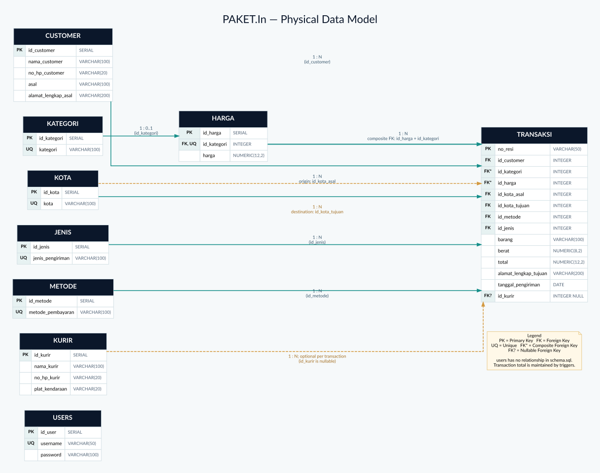

# 📦 PAKET.In — Relational Database Project

**Simulasi basis data layanan ekspedisi menggunakan PostgreSQL 16, master-tariff pricing, dan 15 nested SQL queries.**

[](https://www.postgresql.org/docs/16/)
[](https://www.postgresql.org/)
[](https://github.com/tatavvaka/PAKET.In_KEL7/actions/workflows/postgres-validation.yml)
[](LICENSE)

## About This Project

PAKET.In adalah proyek akademik untuk merancang dan menguji basis data relasional pada skenario layanan ekspedisi. Repository ini berfokus pada struktur tabel dan relasi, referential integrity, perhitungan tarif berdasarkan master data, serta penggunaan nested SQL queries untuk mengeksplorasi data transaksi.

Implementasi menggunakan PostgreSQL 16 dan mencakup empat skala dataset, sembilan tabel, trigger untuk menjaga nilai total transaksi, serta automated validation melalui GitHub Actions.

> **Project scope:** PAKET.In merupakan portfolio proyek database/SQL. Repository ini tidak menyediakan aplikasi operasional, website layanan ekspedisi, Python notebook, maupun dashboard interaktif.

Seluruh nama customer, nomor kontak, alamat, data kurir, nomor kendaraan, dan akun seed dalam dataset merupakan data sintetis/fiktif untuk kebutuhan akademik dan telah dikonfirmasi aman untuk dipublikasikan.

## Project Objectives

- Merancang relational schema untuk customer, transaksi, kategori, tarif, kota, metode pembayaran, jenis pengiriman, kurir, dan akun.
- Menerapkan primary key, foreign key, unique constraint, check constraint, serta composite foreign key.
- Menetapkan `harga.sql` sebagai sumber tarif master.
- Menjaga perhitungan `total` menggunakan formula `berat × harga master`.
- Menyusun 15 nested SQL queries untuk eksplorasi data ekspedisi.
- Menguji proses import, integritas relasi, sequence, dan pricing triggers menggunakan PostgreSQL 16.

## Project Highlights

| Area | Implementasi |
|---|---|
| Relational schema | 9 tabel |
| Dataset scale | 10, 100, 1.000, dan 10.000 transaksi |
| SQL analysis | 15 nested queries |
| Pricing logic | Master tariff dari `harga.sql` |
| Data integrity | Primary key, foreign key, unique, check, dan composite foreign key |
| Automation | GitHub Actions dengan PostgreSQL 16 |

## Dataset Overview

Repository menyediakan empat skala data transaksi. Setiap skala divalidasi secara terpisah agar ID dan nomor resi dari dataset yang berbeda tidak saling bertabrakan.

| Dataset | Transaction rows | Customer rows | Total setelah master pricing |
|---|---:|---:|---:|
| DATA 10 | 10 | 10 | Rp3.094.000 |
| DATA 100 | 100 | 100 | Rp36.458.000 |
| DATA 1000 | 1.000 | 1.001 | Rp405.759.000 |
| DATA 10000 | 10.000 | 10.000 | Rp3.838.183.000 |

**Catatan DATA 1000:** tabel customer berisi 1.001 baris untuk memenuhi seluruh referensi customer dari 1.000 transaksi. Jumlah transaksi pada dataset ini tetap 1.000.

Jumlah customer pada tabel merupakan jumlah record, bukan klaim jumlah individu unik. Pada CSV sumber terdapat 4.936 nilai nama customer yang berbeda dari 10.000 transaksi. Karena nama bukan identifier yang stabil, record tidak digabung hanya berdasarkan kemiripan nama.

## Data Quality Overview

Audit terhadap `fixx transaksi.csv` dilakukan dengan membandingkan atribut transaksi yang tersedia terhadap dataset SQL dan master data repository. File CSV digunakan sebagai sumber pembanding audit dan tidak disimpan pada repository publik.

| Pemeriksaan | Hasil |
|---|---:|
| Baris transaksi sumber | 10.000 |
| Nomor resi unik | 10.000 |
| Nomor resi duplikat | 0 |
| Nama customer unik | 4.936 |
| Label barang | 10 |
| Kategori master | 6 |
| Kota master | 38 |
| Metode pembayaran | 3 |
| Jenis pengiriman | 4 |
| Baris CSV memenuhi `Total = Harga × Berat` | 10.000 |

### Source-to-SQL reconciliation

Atribut transaksi yang dapat dibandingkan cocok dengan SQL setelah normalisasi ejaan kategori dan kota, parsing tanggal, serta penerapan tarif master. Normalisasi yang teridentifikasi meliputi:

- `Makanana/Minuman` menjadi `Makanan/Minuman`.
- `Jamb` menjadi `Jambi`.
- Terdapat variasi ejaan provinsi seperti `Nusa TenggaraBarat`.

### Catatan kualitas data

- Seluruh 10.000 nilai tanggal berhasil diparse. Sebanyak 3.938 nilai menggunakan titik sebagai pemisah jam-menit, sedangkan 6.062 menggunakan titik dua.
- Rentang tanggal pada CSV adalah 1970–2025. Data ini merupakan dataset simulasi, bukan bukti histori operasional ekspedisi.
- Kolom `tanggal_pengiriman` pada schema menggunakan tipe `DATE`. Karena itu, komponen jam dari sumber tidak disimpan dalam tabel transaksi.
- Kesepuluh label barang muncul pada keenam kategori master. Foreign key memastikan relasi kategori dan tarif valid secara teknis, tetapi belum membuktikan kesesuaian kategori barang secara semantik.
- CSV memiliki satu baris kosong di bagian akhir, satu kolom tanpa nama yang kosong, serta kolom tambahan `Cash` dengan 69 nilai non-kosong yang bercampur dari beberapa referensi. Kolom tersebut tidak diperlakukan sebagai atribut transaksi.

Pemeriksaan kategori-barang dapat ditinjau pada [`queries/audit_kategori_barang.sql`](queries/audit_kategori_barang.sql). Kategori tidak direklasifikasi otomatis karena belum tersedia kamus klasifikasi barang yang disetujui.

## Master Pricing

`harga.sql` merupakan sumber tarif final yang digunakan pada perhitungan transaksi.

| Kategori | Tarif master |
|---|---:|
| Elektronik | Rp20.000/kg |
| Dokumen | Rp8.000/kg |
| Makanan/Minuman | Rp15.000/kg |
| Pakaian | Rp10.000/kg |
| Barang Fragile | Rp22.000/kg |
| Barang Non-Fragile | Rp12.000/kg |

Formula perhitungan:

```text
total = berat × harga master
```

Berat transaksi dipertahankan dari sumber, sedangkan `total` dihitung menggunakan tarif kategori pada `harga.sql`.

### Perbedaan total CSV dan master pricing

| Dasar perhitungan | Total |
|---|---:|
| Total pada CSV sumber | Rp3.729.234.000 |
| Total setelah penerapan tarif master | Rp3.838.183.000 |
| Perubahan total | +Rp108.949.000 |

Sebanyak 8.296 dari 10.000 transaksi memiliki nilai `Harga` sumber yang berbeda dari tarif master untuk kategorinya. Perbedaan ini terjadi karena repository menggunakan `harga.sql` sebagai acuan tarif final; bukan karena perubahan berat transaksi.

Trigger pada `schema.sql` menghitung ulang `total` saat transaksi dimasukkan atau atribut berat/tarif/kategori diperbarui. Trigger pada tabel `harga` juga memperbarui total transaksi terkait ketika tarif master berubah.

## Database Schema

Schema utama berada pada [`schema.sql`](schema.sql) dan terdiri dari sembilan tabel:

| Tabel | Peran |
|---|---|
| `customer` | Identitas customer dan informasi asal |
| `kategori` | Master kategori barang |
| `harga` | Tarif master untuk setiap kategori |
| `kota` | Referensi kota asal dan tujuan |
| `jenis` | Master jenis layanan pengiriman |
| `metode` | Master metode pembayaran |
| `kurir` | Data kurir |
| `users` | Akun seed |
| `transaksi` | Data pengiriman dan total transaksi |

### Relasi utama

- Satu customer dapat memiliki banyak transaksi.
- Satu kategori memiliki maksimal satu baris tarif master karena `harga.id_kategori` bersifat `UNIQUE`.
- Pasangan `(id_harga, id_kategori)` pada transaksi mengacu pada pasangan yang sama di tabel `harga` melalui composite foreign key.
- Tabel `kota` direferensikan dua kali oleh transaksi, yaitu sebagai kota asal (`id_kota_asal`) dan kota tujuan (`id_kota_tujuan`).
- Metode pembayaran, jenis pengiriman, dan kurir direferensikan oleh transaksi.
- `id_kurir` bersifat nullable. Dataset transaksi 10.000 baris tidak memiliki penugasan kurir yang dapat diverifikasi dari CSV sumber.
- Tabel `users` berdiri sendiri dan tidak memiliki foreign key ke tabel lain pada schema saat ini.

### Physical Data Model



Diagram menggambarkan sembilan tabel, primary key, foreign key, unique key, composite foreign key, dan relasi kota asal/tujuan sesuai definisi pada `schema.sql`.

## SQL Analysis — 15 Nested Queries

File [`queries/15_nested_queries.sql`](queries/15_nested_queries.sql) berisi 15 query untuk mengeksplorasi:

1. Transaksi dengan total di atas rata-rata keseluruhan.
2. Customer dengan jumlah transaksi di atas rata-rata jumlah transaksi per customer.
3. Customer dengan total pengeluaran pengiriman di atas rata-rata.
4. Transaksi dengan berat di atas rata-rata berat pada kategori yang sama.
5. Kota tujuan dengan jumlah pengiriman di atas rata-rata volume antarkota.
6. Metode pembayaran dengan frekuensi penggunaan di atas rata-rata.
7. Jenis pengiriman dengan rata-rata berat di atas rata-rata keseluruhan.
8. Kategori dengan tarif master di atas rata-rata tarif.
9. Transaksi dengan total di atas rata-rata pada jenis pengiriman yang sama.
10. Kurir dengan jumlah penugasan di atas rata-rata per kurir.
11. Customer yang tidak pernah menggunakan metode pembayaran COD.
12. Customer yang pernah mengirim ke kota dengan volume pengiriman di atas rata-rata.
13. Kategori yang memiliki transaksi dengan berat di atas rata-rata keseluruhan.
14. Kota yang tercatat sebagai kota asal sekaligus kota tujuan.
15. Customer dengan akumulasi berat pengiriman di atas rata-rata per customer.

Query menggunakan beberapa bentuk nested query, termasuk scalar subquery, correlated subquery, derived table, `IN`, `EXISTS`, dan `NOT EXISTS`.

## Validation & Test Results

Validasi otomatis menggunakan PostgreSQL 16 melalui GitHub Actions. Run terakhir yang diperiksa berhasil menyelesaikan pengujian empat dataset.

[](https://github.com/tatavvaka/PAKET.In_KEL7/actions/workflows/postgres-validation.yml)

| Dataset | Transaksi terimpor | Customer terimpor | Total master |
|---|---:|---:|---:|
| DATA 10 | 10 | 10 | Rp3.094.000 |
| DATA 100 | 100 | 100 | Rp36.458.000 |
| DATA 1000 | 1.000 | 1.001 | Rp405.759.000 |
| DATA 10000 | 10.000 | 10.000 | Rp3.838.183.000 |

Pemeriksaan otomatis mencakup:

- Import schema, master data, customer, dan transaksi.
- Integritas primary key dan foreign key selama proses import.
- Kesesuaian `total` dengan `berat × harga master`.
- Jumlah record customer dan transaksi.
- Kebijakan nullable pada `id_kurir`.
- Tipe kolom `tanggal_pengiriman`.
- Sinkronisasi sequence `SERIAL`.
- Eksekusi 15 nested queries dan query audit kategori-barang.
- Pengujian trigger saat insert transaksi dan perubahan tarif master.

Hasil ini membuktikan keberhasilan import dan pemeriksaan yang tercantum. **Repository belum memuat benchmark waktu eksekusi atau hasil `EXPLAIN ANALYZE`**, sehingga belum ada klaim peningkatan performa atau efisiensi query.

## Tools & Technologies

- **PostgreSQL 16** — relational database management system.
- **SQL** — schema definition, master data, constraints, triggers, dan analytical queries.
- **pgAdmin 4** — pengelolaan dan pemeriksaan database.
- **GitHub Actions** — automated import dan validation workflow.

## Repository Structure

```text
PAKET.In_KEL7/
├── .github/
│   └── workflows/
│       └── postgres-validation.yml
├── DATA 10/
│   ├── customer.sql
│   └── transaksi.sql
├── DATA 100/
│   ├── customer100.sql
│   └── transaksi100.sql
├── DATA 1000/
│   ├── customer1000.sql
│   └── transaksi1000.sql
├── DATA 10000/
│   ├── customer10000.sql
│   └── transaksi10000.sql
├── queries/
│   ├── 15_nested_queries.sql
│   └── audit_kategori_barang.sql
├── scripts/
│   ├── reset_sequences.sql
│   ├── test_pricing_triggers.sql
│   └── validate_postgres.sh
├── schema.sql
├── kategori.sql
├── harga.sql
├── kota.sql
├── jenis.sql
├── metode.sql
├── kurir.sql
├── users.sql
├── pdm.svg
└── LICENSE
```

## Limitations & Data Governance

1. Kesesuaian kategori terhadap nama barang belum dapat dipastikan tanpa kamus klasifikasi yang disepakati.
2. Komponen jam pada tanggal sumber tidak dipertahankan karena schema menggunakan tipe `DATE`.
3. Dataset transaksi DATA 10000 tidak menyediakan penugasan kurir; `id_kurir` dibiarkan nullable.
4. Nilai password pada `users.sql` merupakan akun seed sintetis dan disimpan sebagai teks biasa untuk kebutuhan dataset. Nilai tersebut bukan mekanisme autentikasi produksi dan tidak boleh digunakan ulang untuk akun nyata.
5. Belum ada benchmark performa atau analisis `EXPLAIN ANALYZE` untuk 15 nested queries.
6. Repository berfokus pada SQL/PostgreSQL dan belum menyertakan Python notebook, dashboard, atau aplikasi ekspedisi yang berjalan.
7. Data sintetis dan tanggal historis dalam dataset digunakan untuk latihan akademik, bukan sebagai catatan operasional layanan ekspedisi nyata.

## References

- [PostgreSQL 16 Documentation](https://www.postgresql.org/docs/16/)
- [PostgreSQL — Constraints](https://www.postgresql.org/docs/16/ddl-constraints.html)
- [PostgreSQL — CREATE TABLE](https://www.postgresql.org/docs/16/sql-createtable.html)
- [PostgreSQL — CREATE TRIGGER](https://www.postgresql.org/docs/16/sql-createtrigger.html)
- [PostgreSQL — PL/pgSQL](https://www.postgresql.org/docs/16/plpgsql.html)
- [GitHub Actions Documentation](https://docs.github.com/en/actions)