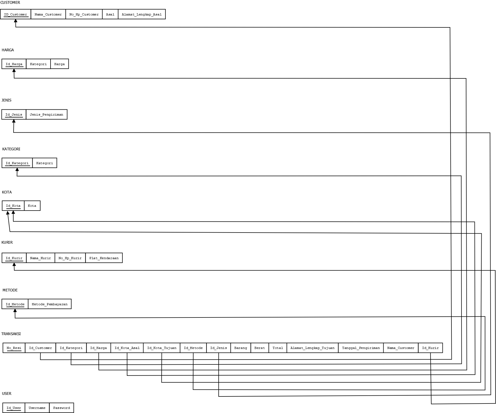

# PAKET.In — Database Management System Ekspedisi

PAKET.In adalah proyek perancangan dan pengujian basis data relasional untuk simulasi layanan ekspedisi. Proyek ini menggunakan PostgreSQL untuk mengelola data pelanggan, kategori barang, tarif, kota, metode pembayaran, jenis pengiriman, kurir, pengguna, dan transaksi.

[](https://github.com/tatavvaka/PAKET.In_KEL7/actions/workflows/postgres-validation.yml)

## Tujuan proyek

1. Merancang skema relasional yang mengurangi redundansi data.
2. Menerapkan primary key, foreign key, constraint, dan relasi antartabel.
3. Menetapkan `harga.sql` sebagai sumber tarif utama.
4. Menguji empat skala data transaksi: 10, 100, 1.000, dan 10.000 baris.
5. Menyusun 15 nested query untuk analisis operasional ekspedisi.
6. Mengotomatisasi pengujian impor dan integritas data menggunakan PostgreSQL 16.

## Teknologi

- PostgreSQL 16
- pgAdmin 4 untuk pengelolaan dan pemeriksaan basis data
- SQL untuk definisi skema, seed data, validasi, dan analisis
- GitHub Actions untuk pengujian impor otomatis

## Struktur basis data

Skema utama berada di `schema.sql`. Tabel yang digunakan:

| Tabel | Fungsi |
|---|---|
| `customer` | Menyimpan identitas dan alamat asal pelanggan |
| `kategori` | Menyimpan kategori barang |
| `harga` | Menyimpan tarif per kategori |
| `kota` | Menyimpan referensi kota asal dan tujuan |
| `jenis` | Menyimpan jenis layanan pengiriman |
| `metode` | Menyimpan metode pembayaran |
| `kurir` | Menyimpan data kurir |
| `users` | Menyimpan akun pengguna sistem |
| `transaksi` | Menyimpan data pengiriman dan biaya transaksi |

Relasi penting:

- Satu customer dapat memiliki banyak transaksi.
- Satu kota dapat digunakan sebagai kota asal maupun kota tujuan.
- Setiap transaksi terhubung ke kategori, tarif, metode pembayaran, dan jenis pengiriman.
- Pasangan foreign key `(id_harga, id_kategori)` pada tabel `transaksi` mengacu ke pasangan yang sama pada tabel `harga`. Constraint ini mencegah transaksi menggunakan tarif yang bukan milik kategorinya.
- `id_kurir` dapat bernilai `NULL` apabila penugasan kurir tidak tersedia atau tidak dapat diverifikasi dari sumber data.

## Master tarif

File `harga.sql` merupakan satu-satunya acuan tarif. Nominal tarif dari CSV tidak digunakan sebagai tarif final.

| ID kategori | Kategori | Tarif |
|---:|---|---:|
| 1 | Elektronik | Rp20.000/kg |
| 2 | Dokumen | Rp8.000/kg |
| 3 | Makanan/Minuman | Rp15.000/kg |
| 4 | Pakaian | Rp10.000/kg |
| 5 | Barang Fragile | Rp22.000/kg |
| 6 | Barang Non-Fragile | Rp12.000/kg |

Rumus perhitungan:

`total = berat × harga master`

Berat pada transaksi dipertahankan dari data sumber. Nilai total dihitung ulang menggunakan tarif berdasarkan `id_harga` dan `id_kategori`.

## Dataset dan hasil audit

Setiap skala dataset harus diuji pada basis data terpisah karena beberapa file menggunakan rentang primary key dan nomor resi yang saling tumpang tindih.

| Dataset | Jumlah transaksi | Jumlah customer | Akumulasi total |
|---|---:|---:|---:|
| DATA 10 | 10 | 10 | Rp3.094.000 |
| DATA 100 | 100 | 100 | Rp36.458.000 |
| DATA 1000 | 1.000 | 1.001 | Rp405.759.000 |
| DATA 10000 | 10.000 | 10.000 | Rp3.838.183.000 |

Catatan DATA 1000: terdapat 1.001 baris customer karena satu transaksi merujuk ke customer ID 1472. Data customer tersebut tersedia pada sumber customer DATA 10000 dan ditambahkan agar foreign key transaksi dapat dipenuhi. Jumlah transaksi DATA 1000 tetap 1.000.

Hasil audit SQL terhadap empat dataset:

- Tidak ditemukan nomor resi duplikat.
- Seluruh referensi customer, kota, kategori, tarif, metode pembayaran, jenis pengiriman, dan kurir dapat di-resolve.
- Tidak ditemukan ketidaksesuaian antara `total` dan `berat × harga master`.
- Seluruh nilai tanggal berhasil dimasukkan ke kolom bertipe `DATE`.
- Seluruh 10.000 transaksi DATA 10000 menggunakan `id_kurir = NULL`, sesuai kebijakan karena penugasan kurir tidak dapat diverifikasi dari sumber.
- DATA 10, DATA 100, dan DATA 1000 tetap menggunakan ID kurir yang tersedia dan valid.

### Catatan kualitas kategori dan barang

Audit menemukan bahwa nama barang yang sama muncul pada beberapa kategori, termasuk seluruh enam kategori master. Dengan demikian, validitas foreign key kategori dan tarif sudah terbukti secara teknis, tetapi kesesuaian semantik antara kolom `barang` dan `kategori` belum dapat dipastikan.

Kategori tidak diubah secara otomatis karena repository belum memiliki kamus klasifikasi barang yang disetujui dan file CSV sumber belum tersedia di repository. Pemetaan kategori-barang perlu ditetapkan berdasarkan sumber yang dapat diverifikasi sebelum data digunakan sebagai data operasional.

## Nested queries

Lima belas query analisis tersedia pada `queries/15_nested_queries.sql`. Cakupannya antara lain:

1. Transaksi dengan total di atas rata-rata.
2. Customer dengan jumlah transaksi di atas rata-rata.
3. Customer dengan total pengeluaran di atas rata-rata.
4. Transaksi dengan berat di atas rata-rata kategori.
5. Kota tujuan dengan volume pengiriman di atas rata-rata.
6. Metode pembayaran dengan frekuensi penggunaan di atas rata-rata.
7. Jenis pengiriman dengan rata-rata berat di atas rata-rata keseluruhan.
8. Kategori dengan tarif di atas rata-rata tarif master.
9. Transaksi dengan total di atas rata-rata jenis pengiriman.
10. Kurir dengan jumlah penugasan di atas rata-rata.
11. Customer yang tidak pernah menggunakan COD.
12. Customer yang mengirim ke kota dengan volume pengiriman tinggi.
13. Kategori yang memiliki transaksi dengan berat di atas rata-rata.
14. Kota yang menjadi asal sekaligus tujuan pengiriman.
15. Customer dengan akumulasi berat pengiriman di atas rata-rata.

Query menggunakan scalar subquery, correlated subquery, derived table, `IN`, `EXISTS`, dan `NOT EXISTS`.

## Cara menjalankan pada PostgreSQL

Buat satu database untuk setiap dataset. Contoh berikut untuk DATA 10:

```bash
createdb paketin_10

psql -d paketin_10 -f schema.sql

psql -d paketin_10 -f kategori.sql
psql -d paketin_10 -f harga.sql
psql -d paketin_10 -f kota.sql
psql -d paketin_10 -f jenis.sql
psql -d paketin_10 -f metode.sql
psql -d paketin_10 -f kurir.sql
psql -d paketin_10 -f users.sql

psql -d paketin_10 -f "DATA 10/customer.sql"
psql -d paketin_10 -f "DATA 10/transaksi.sql"

psql -d paketin_10 -f scripts/reset_sequences.sql
psql -d paketin_10 -f queries/15_nested_queries.sql
```

Untuk dataset lain, gunakan file customer dan transaksi yang sesuai. Jangan mengimpor DATA 10, DATA 100, DATA 1000, dan DATA 10000 ke database yang sama tanpa proses pembersihan karena nomor resi dan ID dapat bertabrakan.

### Pengujian otomatis

Jalankan:

```bash
bash scripts/validate_postgres.sh
```

Skrip tersebut membuat database uji terpisah dengan awalan `paketin_ci_`, mengimpor skema dan seluruh dataset, menyelaraskan sequence `SERIAL`, lalu memeriksa jumlah baris, foreign key, rumus tarif, total transaksi, tipe tanggal, kebijakan kurir, dan eksekusi 15 nested query.

**Peringatan:** skrip validasi menghapus database uji dengan nama `paketin_ci_10`, `paketin_ci_100`, `paketin_ci_1000`, dan `paketin_ci_10000` sebelum membuatnya kembali. Jalankan hanya pada lingkungan pengujian.

GitHub Actions menjalankan validasi yang sama menggunakan PostgreSQL 16 pada push dan pull request ke `main`.

## Batasan dan tindak lanjut

1. Menetapkan kamus klasifikasi barang agar kategori sesuai dengan isi paket.
2. Memastikan kembali data sumber CSV dan dokumentasi transformasinya.
3. Mengganti penyimpanan password pada `users.sql` dengan mekanisme hash yang sesuai. File saat ini berisi nilai password seed dalam teks biasa; jangan gunakan nilai tersebut sebagai kredensial produksi. Jika ada nilai yang digunakan pada akun nyata, segera rotasi.
4. Melakukan pengukuran waktu eksekusi 15 nested query pada setiap skala dataset sebelum menyimpulkan perbandingan performa.

## Diagram


